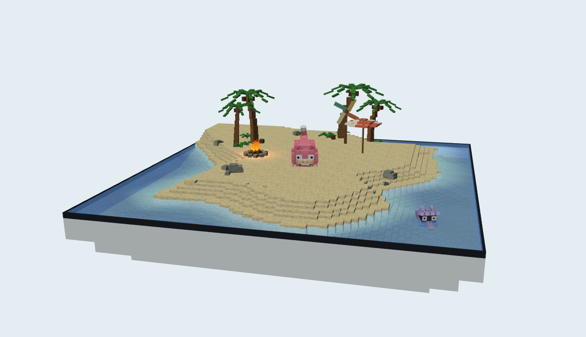
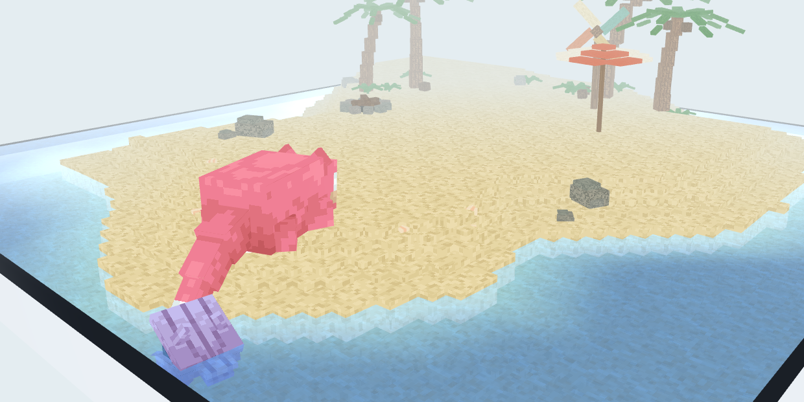
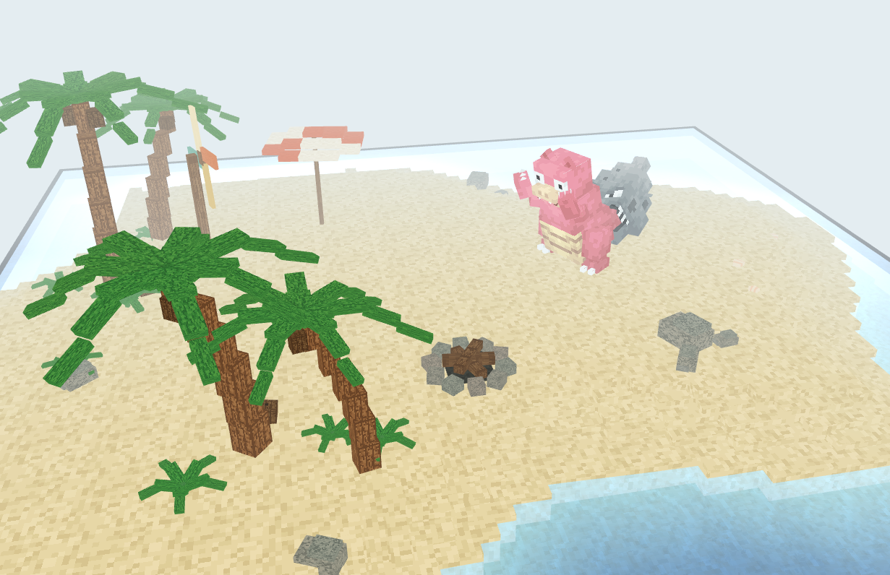

# Paraíso Pokémon

Trabalho Prático 2 de Computação Gráfica, desenvolvido em JavaScript, WebGL e TWGL.js.

## A Cena

Um diorama de praia inspirado no estilo em blocos do Minecraft, com Slowpoke passeando pela areia e Shellder nadando no mar. A base da pokébola e sua parte inferior são representadas por blocos, acompanhando a proposta visual. O cenário inclui relevo, coqueiros, samambaias, pedras, cocos, conchas, guarda-sol, catavento e uma base de fogueira.

Slowpoke possui quatro poses: em pé, dormindo deitado, deitado acordado e deitado na margem com a cauda na água. Na quarta pose, após uma espera de 5 segundos, Shellder se aproxima e morde a cauda. Um efeito de brilho e partículas revela Slowbro, que retorna ao interior da ilha e passa a caminhar pelo cenário.

O fundo é um skybox com céu em degradê azul, sem nuvens. O céu acompanha a câmera e destaca a base branca da pokébola. A neblina mantém o tom branco suave original.

A cena possui duas câmeras, iluminação Blinn-Phong, texturas pixeladas, água transparente com ondas e textura animada, vento na vegetação e neblina. A fogueira permanece acesa com chamas em blocos animados e uma luz pontual alaranjada que oscila e ilumina os objetos próximos. Os personagens seguem caminhos internos que consideram terreno, obstáculos e limites da base.

### Como executar

Abra a pasta do projeto no Visual Studio Code e inicie `index.html` pela extensão **Live Server**. A aplicação precisa ser servida por HTTP para carregar os módulos, modelos, texturas e shaders. Não há etapa de compilação nem instalação de pacotes.

### Controles

| Tecla ou ação | Função |
| --- | --- |
| `1` | Câmera automática, orbitando o centro a aproximadamente 45° acima do chão. |
| `2` | Câmera orbital manual. |
| Arrastar com o botão esquerdo | Girar a câmera manual. |
| Scroll | Aproximar ou afastar a câmera nos dois modos. |
| `L` | Ativar/desativar a iluminação. |
| `N` | Mostrar/esconder a neblina. |
| `P` | Alternar entre as quatro poses de Slowpoke. |
| `M` | Pausar/retomar os passeios; quando Slowpoke está em uma pose, sair dela e retomar o passeio. |
| `R` | Reiniciar os personagens e a evolução, restaurando Slowpoke e Shellder separados. |

No painel **Comandos**, o seletor **Troca de poses** permite caminhar até a pose ou teletransportar para sua posição e orientação finais.

Antes da mordida, `P` e `M` podem cancelar a aproximação de Shellder. Durante a mordida e a transformação, essas teclas ficam bloqueadas. Após a evolução, Slowbro mantém uma postura padrão: `P` não altera sua pose e `M` controla seu passeio. `R` funciona em qualquer fase e preserva as configurações de câmera, iluminação e neblina.

A cena não reproduz áudio. Os sons originais estão separados para escuta manual em [ouvir.html](assets/sons-para-ouvir/ouvir.html).

## Criador(es)

| Nome | Contato |
| --- | --- |
| Caio Costa Cunha | [GitHub — C4io988](https://github.com/C4io988) |
| João Pedro da Silva Santos | [GitHub — joopedriantos](https://github.com/joopedriantos) |

## Media kit

Visão geral da ilha com Slowpoke na areia e Shellder na água.

Detalhes da vegetação, do catavento e dos objetos que compõem o cenário.

Slowbro no cenário após a evolução.

## Opcionais

Foram implementados **11 itens opcionais**. Os trechos em citação abaixo reproduzem as descrições dos respectivos requisitos do enunciado; em seguida, é descrita sua aplicação no projeto.

### 1. Modelos tridimensionais

> **Modelos tridimensionais**: em vez de usar os sólidos próprios ou da TWGL.js, crie ou use modelos tridimensionais de terceiros e carregue-os no seu programa. Um formato simples é o `.obj` (mas ele não suporta animação). Tem também o formato glTF (mais complexo mas suporta animação)

Modelos de Slowpoke, Shellder e Slowbro do Cobblemon, carregados a partir de arquivos JSON no formato Bedrock, com hierarquia de ossos, cubos e texturas. Implementação em `src/cobblemon.js` e `src/recursos.js`.

### 2. Chão com relevo

> **Chão com relevo**: em vez de plano, faça com que o chão tenha relevo. Uma ideia é usar um _height-map_: uma textura em escala de cinza em que cada texel representa a altura do chão naquele pixel.

Ilha gerada proceduralmente com patamares de areia e fundo submerso em degraus. A altura do terreno também é usada para posicionar os objetos e orientar a navegação. Implementação em `src/praia.js` e `src/base.js`.

### 3. Vários tipos de objetos

> **Vários tipos de objetos**: em vez de compor o cenário com apenas 03 tipos de objetos, tenha uns 07 tipos diferentes para dar variedade

O cenário tem oito tipos de objetos: coqueiros, samambaias, pedras, cocos, conchas, guarda-sol, catavento e base de fogueira. O catavento também atende ao objeto hierárquico obrigatório, com haste fixa e hélice giratória. Implementação em `src/cenario.js`.

### 4. Vento

> **Vento**: simule que existe vento e faça as coisas mexerem com ele. Por exemplo, aplique um _shear_ com uma intensidade dada, em um certo momento, por uma textura que contém ruído branco (eg, _perlin noise_). Moitas de grama e a copa das árvores podem sofrer essa transformação

Vento direcional com intensidade variável deforma as folhas dos coqueiros e samambaias. Ele também influencia a rotação do catavento, as ondas e o deslocamento da textura da água. Implementação em `src/ambiente.js`, `src/cenario.js` e nos shaders da vegetação e da água.

### 5. Líquido

> **Líquido**: tenha uma região aquática como um lago, poça d'água, mar ou rio. Uma ideia para que um sólido pareça água é que ele (a) tenha certa transparência, (b) tenha uma textura com suas coordenadas animadas e (c-para oceano ou rio agitado) desloque verticalmente os vértices da superfície ao longo do tempo para criar ondas

Mar com transparência, duas camadas de textura animada, ondas visíveis pelo deslocamento vertical dos vértices e cor/opacidade conforme a profundidade. As ondas são amortecidas junto à borda externa. Shellder acompanha sua altura, mantendo folga sobre o fundo. Implementação em `src/agua.js`, `src/ondas.js` e `src/shaders/agua.*.glsl`.

### 6. Poses alternativas

> **Poses alternativas**: ao alternar as poses do personagem com `P`, além de mudar a posição e orientação, coloque-o de fato em outra pose (eg, sentado, deitado, dormindo)

As quatro poses de Slowpoke mudam sua posição, orientação e postura. Há poses deitado dormindo, deitado acordado e com a cauda mergulhada. Implementação em `src/poses.js` e `src/personagens.js`.

### 7. Movimentação autônoma

> **Movimentação autônoma**: dê vida ao personagem fazendo-o andar pelo cenário. Deve haver uma máquina de estados com pelo menos as situações: (a) _idle_ e (b) _wandering_. O personagem deve andar apenas por locais válidos
>
> - Pode ser necessário ter um grafo não direcionado em que cada nó representa um possível local de destino e as arestas existem entre nós que podem ser alcançados andando em linha reta
> - Ao entrar em _wandering_, o grafo pode ser consultado para escolher um nó alvo que seja alcançável a partir da navegação de algumas arestas escolhidas de forma aleatória

Slowpoke e Slowbro alternam entre repouso (`idle`) e passeio (`wandering`). Shellder alterna entre repouso e nado. Grafos por região, busca de rotas e percursos curvos validam os deslocamentos considerando espaço para o corpo, terreno, obstáculos e bordas. Implementação em `src/navegacao.js`, `src/personagens.js`, `src/shellder.js` e `src/slowbro.js`.

### 8. Efeitos de partículas

> **Efeitos de partículas**: para simular fenômenos como fogo, fumaça, água etc.

A evolução emite 40 partículas em forma de cubos ao redor dos personagens, com movimento, variação de tamanho/cor e transparência ao longo do efeito. A fogueira também possui 24 partículas em blocos, que sobem, mudam do amarelo para o vermelho e diminuem até desaparecer, com desvio na direção do vento. Implementação em `src/efeito-evolucao.js`, `src/shaders/evolucao.*.glsl` e `src/cenario.js`.

### 9. Neblina

> **Neblina**: funcionalidade acrescentada por comando do teclado (`N`), podendo ser habilitada e desabilitada durante a execução

Neblina por distância aplicada ao cenário, personagens, água e partículas. Começa ativa, acompanha a distância da câmera e pode ser alternada com `N`. Implementação em `src/ambiente.js` e nos shaders GLSL.

### 10. Fontes de luz pontuais

> **Fontes de luz pontuais**: coloque fontes de luz em alguns objetos do cenário (eg, luz no poste ou uma poça de gosma radioativa)

A fogueira emite luz alaranjada com intensidade oscilante e atenuação por distância, iluminando o terreno e os objetos próximos. A tecla `L` também ativa/desativa essa contribuição de luz; as chamas continuam visíveis. Implementação em `src/cenario.js`, `src/main.js` e nos shaders de iluminação do cenário e da água.

### 11. Skybox

> **Skybox, skyphere ou skydome**: se considerarmos que nosso mundo está definido dentro de um cubo (skybox), podemos colocar uma imagem de textura em cada face interna (são 6) que represente o horizonte naquela direção.

Céu em degradê azul, sem nuvens, usando uma textura cúbica de seis faces geradas proceduralmente no projeto. O fundo acompanha a câmera, sem aproximação das paredes ao usar zoom. A neblina mantém o tom branco suave original. Implementação em `src/ceu.js` e `src/shaders/ceu.*.glsl`.

## Créditos

- **Geometrias do cenário, texturas procedurais, skybox em degradê e efeito visual de evolução:** criados no projeto. O cenário adota uma estética em blocos inspirada em Minecraft; não utiliza arquivos de textura do Minecraft.
- **TWGL.js 7.0.0:** [Gregg Tavares](https://github.com/greggman/twgl.js), sob [licença MIT](https://opensource.org/license/mit). A biblioteca está em `vendor/twgl-full.module.js`, com seus avisos de licença preservados.
- **Modelos, texturas, animações de referência e sons de Slowpoke, Shellder e Slowbro:** equipe [Cobblemon](https://gitlab.com/cable-mc/cobblemon), versão 1.7.3. Consulte a [licença dos recursos](https://gitlab.com/cable-mc/cobblemon-assets/-/blob/master/LICENSE). As animações foram adaptadas para o projeto; os sons permanecem separados para escuta manual.

Detalhes sobre a procedência dos recursos em [`docs/origem-recursos.md`](docs/origem-recursos.md).
